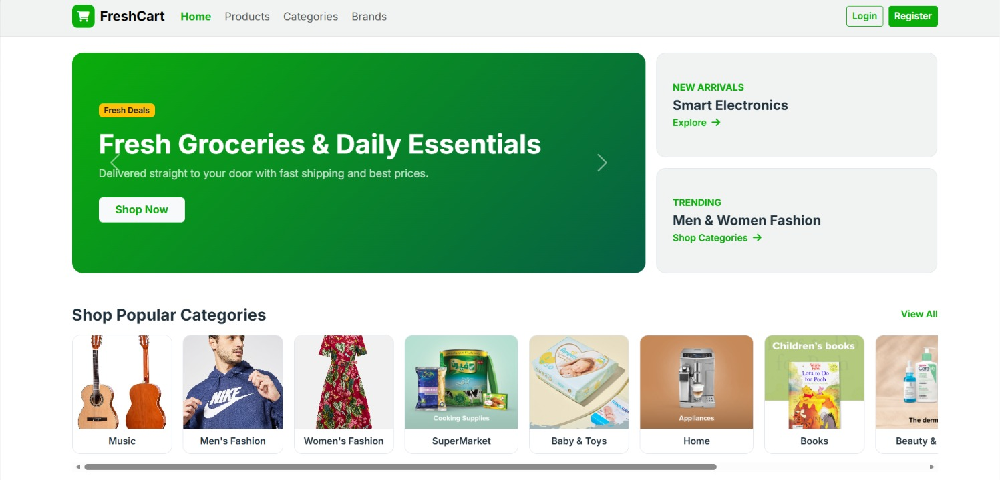
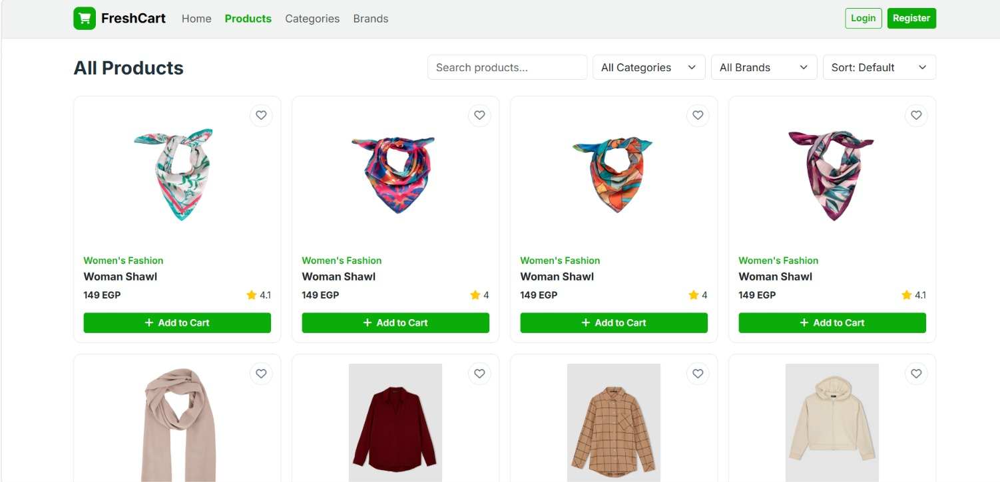
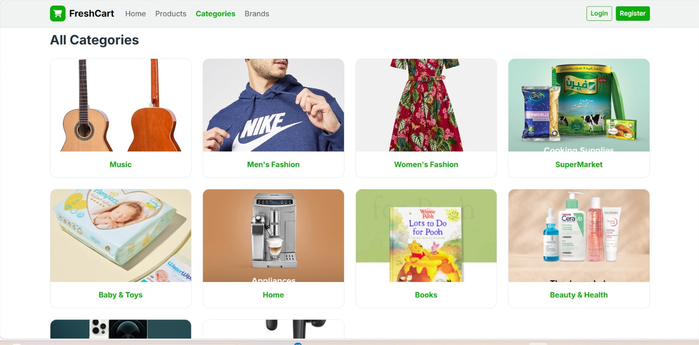
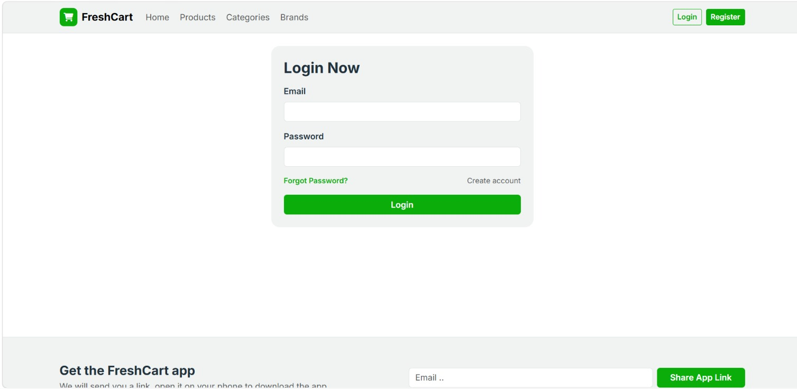
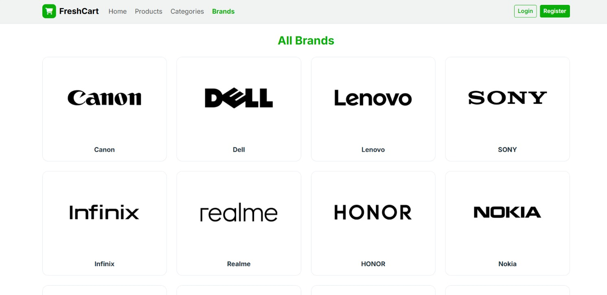
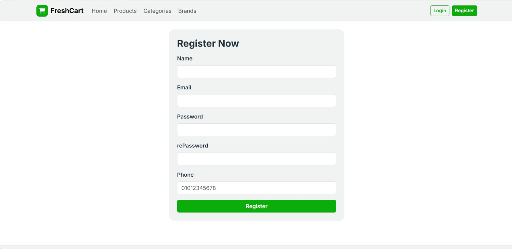

# 🛒 FreshCart | E-Commerce Website

A responsive e-commerce web application built with HTML, CSS, JavaScript, Bootstrap, and REST API integration.

FreshCart provides an interactive online shopping experience, allowing users to browse products, explore categories, manage their shopping cart, and place orders.

## 🌐 Live Demo

**[View Live Website](https://sandy-mohamed.github.io/FreshCart-Ecommerce/)**

## 📸 Screenshots

### Home Page


### Products Page


### Categories Page


### Login


### Brands Page


### Register


## ✨ Features

- 🔐 User registration, login, and password recovery
- 🛍️ Product listings and detailed product pages
- 🔎 Product search, filtering, and sorting
- 📂 Browse products by categories and brands
- 🛒 Add, update, and remove shopping cart items
- ❤️ Wishlist management
- 💳 Checkout integration and cash-on-delivery ordering
- 📦 Order history
- 👤 User profile management
- 📱 Responsive layout for different screen sizes
- 🔔 Interactive notifications and loading indicators

## 🛠️ Technologies Used

- **HTML5** — Page structure
- **CSS3** — Custom styling
- **JavaScript (ES6+)** — Application logic and interactivity
- **Bootstrap 5** — Responsive layout and UI components
- **REST APIs** — Product data, authentication, cart, and orders
- **SweetAlert2** — Interactive notifications
- **Font Awesome** — Icons

## 📁 Project Structure

```text
freshcart/
├── index.html
├── css/
│   └── style.css
└── js/
    ├── api.js
    └── app.js
```

## 🚀 Getting Started

1. Clone or download this repository.
2. Open the project folder.
3. Launch `index.html` in your browser.
4. Make sure you have an internet connection to load external libraries and API data.

## 📌 Project Notes

This project is a front-end application that integrates with the RouteMisr E-Commerce REST API. Authentication, shopping cart, and order-related features depend on the external API service.

## 👩‍💻 Developer

**Sandy Mohamed**

Front-End Developer

[GitHub Profile](https://github.com/sandy-mohamed)
